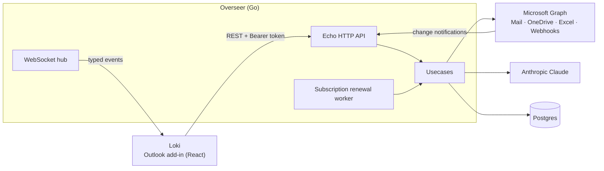
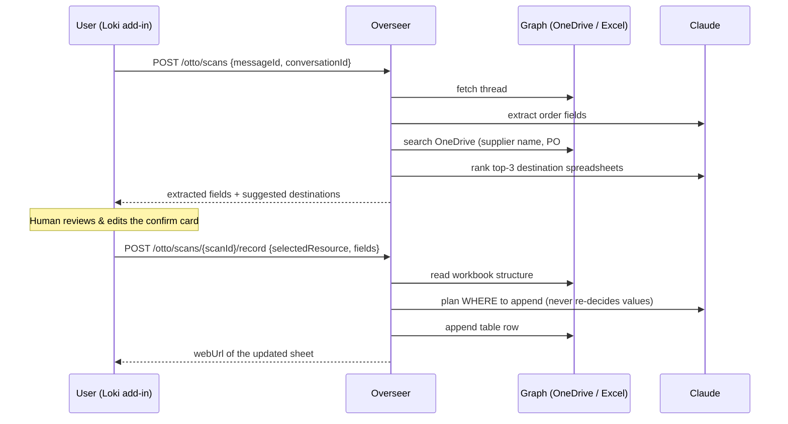

# Overseer

**Overseer** is the Go backend for **Scout** — ThirdEye's procurement AI assistant for wholesale distributors. It watches an operator's Outlook inbox through Microsoft Graph, uses Claude to turn messy supplier email threads into structured order data, and hands the operator a live order list, discrepancy alerts, and one-click ERP entry — all inside Outlook.

> **Naming cheat sheet:** **Scout** is the product · **Overseer** is this backend · **Loki** is the Outlook add-in UI (separate repo) · **Otto** is the email→ERP hero feature.



## Video Demo of BE 


<video src="https://github.com/user-attachments/assets/3164e5a3-67b0-4141-891d-084dac13eec2" controls width="600"></video>


A core design decision: **mail is never stored**. Overseer keeps only derived state (orders, discrepancies, scans) in Postgres and re-fetches threads from Graph on demand. The mailbox stays the source of truth.

---

## Features

| Feature | What it does | Status |
|---|---|---|
| **Order List — Sync** | One-time onboarding backfill: reads ~30 days of inbox, LLM-filters to order threads, extracts structured fields per thread | ✅ Built |
| **Order List — Live** | Graph webhooks keep the list current: every new supplier email is classified, extracted, and merged into its order in real time | ✅ Built |
| **Otto — email → ERP** | Extracts an order from a thread, finds the right spreadsheet in OneDrive, and — after human approval — appends the row to Excel | ✅ Built |
| **Thread Audit** | On every new message in a known order thread, compares it against the full history and flags discrepancies (price / date / unit) | ✅ Built |
| **Check-ups** | Scheduled follow-up emails to suppliers | 🔜 Specced, not yet built |

### Order List — Onboarding Sync

`POST /sync` returns `202 {syncId}` immediately and runs the backfill in the background:

1. `graph.ListMessages` pulls the last 30 days of inbox.
2. `llm.FilterOrderMessages` keeps only order-related conversations (one cheap pass over the whole batch).
3. Messages are grouped into threads; `llm.ExtractOrderFields` pulls supplier, PO number, status, estimated dates, and a supporting quote from each.
4. Orders are upserted idempotently on `(user_id, conversation_id)` — all LLM work finishes before any DB write, so a failed sync never leaves a partial seed.
5. A `sync.completed` event lands on the websocket.

The list is then served by `GET /orders` with status filtering and cursor pagination.

- Usecase: [`overseer/internal/usecase/orders/build_active_order_list.go`](overseer/internal/usecase/orders/build_active_order_list.go), [`format_initial_order_data.go`](overseer/internal/usecase/orders/format_initial_order_data.go)

### Order List — Live updates (Post-Sync)

`POST /subscriptions` registers a Microsoft Graph change-notification subscription for the user's inbox. From then on:

1. Graph POSTs to `POST /webhooks/graph` on every new message (authenticated by a shared `clientState` secret, not the bearer middleware). The handler echoes Graph's validation handshake and enqueues real notifications for background processing.
2. `HandleChangeMessage` resolves the subscription to a user, fetches the message, classifies it if the conversation is unseen, extracts fields, and **merge-upserts** the order — new information folds in without clobbering existing fields.
3. An `order.updated` event is pushed to the websocket, then the Audit leg runs (below).

Graph subscriptions expire after ~3 days, so a background worker ticks hourly and renews anything within 12 h of expiry (TTL 48 h).

- Usecases: [`overseer/internal/usecase/messages/handle_change_message.go`](overseer/internal/usecase/messages/handle_change_message.go), [`overseer/internal/usecase/subscriptions/`](overseer/internal/usecase/subscriptions/)

### Otto — email → ERP entry (human-in-the-loop)

Otto is a strict two-phase flow: **nothing is ever written to the ERP without explicit human approval.**



- **Scan** persists an `otto_scans` row so the record step operates only on what the user saw and approved.
- **Record** replays *approved fields only* — the LLM plans placement (which table, column mapping) but the values written are exactly what the user confirmed. Recording twice returns `409`; an unknown scan returns `404`.
- Usecases: [`overseer/internal/usecase/otto/resolve_destinations.go`](overseer/internal/usecase/otto/resolve_destinations.go), [`record_order.go`](overseer/internal/usecase/otto/record_order.go)

### Thread Audit — discrepancy detection

Audit has no infrastructure of its own; it rides the webhook job. When a new message arrives in a *known* order conversation:

1. `graph.ListConversationMessages` re-fetches the full thread.
2. `llm.FindDiscrepancies` compares the new message against the history — did the price change? the date slip? the quantity shrink?
3. Each finding is stored with a priority (`high`/`medium`/`low`), a metric type (`price`/`date`/`unit`), the supporting quotes, and a deep link back to the email — then pushed as a `discrepancy.found` event.

A clean thread stores nothing, and the first message of a conversation never audits (there's no history to contradict). Findings are listed via `GET /discrepancies` and cleared via `PATCH /discrepancies/{id}` (`open` → `resolved`/`dismissed`).

- Usecase: [`overseer/internal/usecase/orders/catch_discrepancies.go`](overseer/internal/usecase/orders/catch_discrepancies.go)

### Realtime channel

One websocket — `GET /ws` — carries every push the UI needs as typed events: `{"type": "...", "data": {...}}`. Current event types: `sync.completed`, `order.updated`, `discrepancy.found`. New features add event types, never new sockets. Clients only listen; inbound frames are discarded.

### Auth (MVP)

Every route except the webhook requires `Authorization: Bearer <Graph token>` — the add-in's own Graph-scoped token, passed straight through to Microsoft Graph. The MVP is single-user: any valid-looking token resolves to the seeded user, and the last-seen token is cached in memory so background jobs (webhooks, renewals) can call Graph on the user's behalf.

---

## API surface

All routes live in [`overseer/internal/controller/http/router.go`](overseer/internal/controller/http/router.go).

| Method | Path | Purpose | Success |
|---|---|---|---|
| `POST` | `/sync` | Kick off onboarding inbox sync (async) | `202 {syncId}` |
| `GET` | `/orders` | Order list — `?status=&cursor=&limit=` | `200 {orders, nextCursor}` |
| `GET` | `/ws` | The single realtime channel | `101` upgrade |
| `POST` | `/subscriptions` | Create/replace the user's Graph subscription | `201` |
| `GET` | `/discrepancies` | List audit findings — `?status=` | `200` |
| `PATCH` | `/discrepancies/:discrepancyId` | Update a finding's status | `200` |
| `POST` | `/otto/scans` | Ask Otto: extract fields + top-3 destinations | `200` |
| `POST` | `/otto/scans/:scanId/record` | Human-approved write to Excel | `200 {webUrl, status}` |
| `POST` | `/webhooks/graph` | Graph change notifications (`clientState`-authed, no bearer) | `200` / `202` |

Wire DTOs are camelCase and live in [`dto.go`](overseer/internal/controller/http/dto.go); `userId`/`accountId` always come from auth context, never the request body.

---

## Architecture

### The one rule

```
controller / worker  →  usecase  →  gateway / repo
```

Dependencies point inward, never back up. Each usecase package declares the small interfaces (**ports**) it needs in its own `ports.go`; gateways and repos satisfy them structurally and never import usecases. The composition root ([`overseer/cmd/overseer/main.go`](overseer/cmd/overseer/main.go)) is the only place layers are wired, and it carries compile-time conformance assertions (`var _ orders.MessageLister = (*graph.Client)(nil)`) so signature drift fails the build.

### Layout

```
overseer/
├── cmd/overseer/            # composition root: config, wiring, workers
├── db/migrations/           # dbmate migrations (also embedded, auto-applied at startup)
└── internal/
    ├── entity/              # domain types — no JSON/DB tags, stdlib + uuid only
    ├── usecase/
    │   ├── orders/          # sync, list, audit, discrepancy status
    │   ├── messages/        # webhook job (HandleChangeMessage)
    │   ├── otto/            # scan (ResolveDestinations) + record (RecordOrder)
    │   └── subscriptions/   # ensure + renew Graph subscriptions
    ├── gateway/
    │   ├── graph/           # Microsoft Graph mail + subscriptions
    │   ├── drive/           # OneDrive search / recents / item lookup
    │   ├── excel/           # workbook structure + table row append
    │   └── llm/             # Anthropic Claude: prompts, retries, validation, cost logging
    ├── repo/                # Postgres via pgx — all SQL lives here
    ├── controller/http/     # Echo router, auth middleware, controllers, DTOs
    ├── controller/ws/       # realtime hub
    ├── tokencache/          # in-memory per-user Graph token cache
    └── testutil/            # shared fakes for E2E tests
```

Gateways are deliberately dumb adapters — no business decisions, no DB access. All orchestration (including the LLM agent loops) lives in usecases.

### Tech stack

| Layer | Choice |
|---|---|
| Language | Go 1.26 |
| HTTP | Echo v4 |
| Realtime | gorilla/websocket |
| Database | Postgres 16 (pgx v5 / pgxpool) |
| Migrations | dbmate (CLI + embedded at startup) |
| LLM | Anthropic Go SDK — default model `claude-opus-4-8`, structured JSON output |
| External API | Microsoft Graph v1.0 (mail, subscriptions, OneDrive, Excel) |

### Database

Every domain table carries `account_id` + `user_id`. Migrations in [`overseer/db/migrations/`](overseer/db/migrations/) are the source of truth.

| Table | Stores |
|---|---|
| `accounts` | Tenant — the distributor company |
| `users` | Operator whose mailbox is watched (unique email) |
| `graph_subscriptions` | One Graph webhook subscription per user, with expiry for the renewal worker |
| `orders` | Derived order list — keyed for upsert on `(user_id, conversation_id)`; supplier, PO number, status, original/current est. dates, last messenger, supporting quote |
| `discrepancies` | Audit findings — status, priority, title, JSONB detail + quotes, email deep link |
| `otto_scans` | One Ask-Otto interaction — extracted fields (JSONB), selected destination, status (`scanned`/`recorded`/`abandoned`) |

Domain enums (`OrderStatus`: `in_transit`/`confirmed`/`delivered`/`issue`, discrepancy status/priority/metric, scan status) are declared once in `internal/entity` and enforced both at the LLM boundary and as DB CHECK constraints.

---

## Running it

```sh
cd overseer
cp .env.example .env         # fill in ANTHROPIC_API_KEY
make db-up                   # Postgres via docker compose
make run                     # migrations auto-apply, then serve :8080
```

### Configuration

| Env var | Default | Purpose |
|---|---|---|
| `PORT` | `8080` | HTTP listen port |
| `DATABASE_URL` | local Postgres DSN | Also read by the dbmate CLI |
| `ANTHROPIC_API_KEY` | — (required) | LLM gateway |
| `LLM_MODEL` | `claude-opus-4-8` | Model override |
| `PUBLIC_BASE_URL` | `http://localhost:8080` | Where Graph reaches `/webhooks/graph` |
| `GRAPH_CLIENT_STATE` | `overseer-dev-client-state` | Shared secret in every Graph notification |
| `SEED_ACCOUNT_NAME` / `SEED_USER_EMAIL` | dev values | Single-user MVP seed |
| `LOG_LEVEL` | `info` | `debug` logs raw LLM responses |

`make run` sources `.env`; the binary itself reads only real env vars (12-factor). Migrations also run standalone: `make migrate`, `make migrate-status`.

### Testing

```sh
make test    # no DB, no network
```

Three tiers:

- **Usecase unit tests** — every usecase tested against hand-written fakes of its ports.
- **Controller E2E tests** — full HTTP request → response through the real router, middleware, and usecases, with only the outermost adapters faked (fake Graph/LLM/Drive/Excel, in-memory repos, event recorder). See `*_e2e_test.go` in [`overseer/internal/controller/http/`](overseer/internal/controller/http/).
- **Live LLM eval** — [`filter_live_test.go`](overseer/internal/gateway/llm/filter_live_test.go) runs the real model against a production inbox fixture (including the account-security junk that fooled the filter in the wild); skipped unless `ANTHROPIC_API_KEY` is set.

---

## Repository map

```
.
├── overseer/           # the Go backend (everything above)
├── docs/tech_spec.md   # the full Scout product & tech spec — the authoritative source
├── .ai/                # ARCHITECTURE.md + Go code-organization conventions
└── Building-Journal/   # per-feature build journals (sync, post-sync, audit, Otto)
```

Every feature so far has followed the same build path, and it's all journaled: plan → entity + migration → gateway methods → repo → usecase → controller wiring → E2E test.

## Status & roadmap

- **Built:** Order List sync + live updates, Graph subscription lifecycle, Thread Audit, Otto scan/record, realtime channel.
- **Next:** **Check-ups** — scheduled supplier follow-up emails, with cancel-on-reply hooking into the existing webhook job.
- **Known MVP constraints:** single-user auth (any token resolves to the seeded user); Graph tokens cached in memory rather than a durable refresh-token flow; Otto scan runs synchronously.

---

## Guide: adding tests for a feature

Every feature in this repo ships with the same three test layers, and none of them touch a database or the network — `make test` runs cold, fast, and deterministic.

| Layer | What it proves | Where it lives |
|---|---|---|
| **Usecase unit test** | The business logic, against hand-written fakes of the usecase's own ports | Next to the usecase, e.g. [`record_order_test.go`](overseer/internal/usecase/otto/record_order_test.go) |
| **Controller E2E test** | The full HTTP journey — real router, real auth middleware, real usecases; only the outermost adapters faked | [`overseer/internal/controller/http/*_e2e_test.go`](overseer/internal/controller/http/) |
| **Gateway test** | The adapter speaks the external API's actual wire protocol | `httptest`-server tests, e.g. [`graph_test.go`](overseer/internal/gateway/graph/graph_test.go) |

### The shared fake toolbox

[`overseer/internal/testutil/fakes.go`](overseer/internal/testutil/fakes.go) holds one fake per outer adapter. They all follow the same design: **script the outputs with public fields, record the inputs in public slices/counters**, so tests read as *arrange → act → assert* with zero mock-framework ceremony.

| Fake | Stands in for | Script fields → recorded calls |
|---|---|---|
| `FakeGraph` | Graph mail + subscriptions | `Messages`, `MessagesByID`, `ConversationsByID` → `GetCalls`, `ConversationsFetched`, `TokensSeen` |
| `FakeLLM` | Claude | `FilterResult`, `Extractions`, `Findings`, `RankResult`, `PlanResult` → `ExtractCalls`, `PlanFieldsSeen`, … |
| `FakeDrive` / `FakeExcel` | OneDrive / Excel | `SearchResults`, `RecentItems`, `Structures` → `QueriesSeen`, `Appends` |
| `InMemOrders` / `InMemDiscrepancies` / `InMemOttoScans` / `InMemSubscriptions` | Postgres repos | seed via `Upsert`/`Insert`/`AddUser` → `Count()`, `All()` |
| `EventRecorder` | The `/ws` hub | — → `Events`, `OfType(t)` |
| `FakeTokens` / `StaticResolver` | Token cache / auth | `Put(userID, token)` / fixed `User` |

### Anatomy of an E2E test

`newEnv(t)` in [`orders_e2e_test.go`](overseer/internal/controller/http/orders_e2e_test.go) builds a fully wired `httptest.Server` — real `NewRouter`, real usecases, fakes at the edges — and hands back the `env` struct so your test can reach every fake. Two details make it deterministic: `Dispatch` runs jobs synchronously (no goroutine races), and `StaticResolver` mimics single-user auth.

Adding a test to an existing feature is three steps: **seed the fakes, hit the endpoint, assert the body *and* the side effects**:

```go
func TestPostSync_SeedsOrderAndPublishesEvent(t *testing.T) {
	e := newEnv(t)
	// 1. Arrange: script what Graph and the LLM "would" return
	e.graph.Messages = []entity.EmailMessage{
		{ID: "m1", ConversationID: "conv-a", Subject: "PO #4471 confirmed"},
	}
	e.llm.FilterResult = []string{"conv-a"}
	e.llm.Extractions = map[string]entity.OrderExtraction{
		"conv-a": {CompanyName: "Delmar Tooling", OrderID: 4471, Status: entity.OrderStatusConfirmed},
	}

	// 2. Act: real HTTP through the real router + middleware
	resp, _ := e.request(t, http.MethodPost, "/sync", true)

	// 3. Assert: response AND side effects
	if resp.StatusCode != http.StatusAccepted {
		t.Fatalf("status = %d, want 202", resp.StatusCode)
	}
	if e.repo.Count() != 1 {
		t.Errorf("orders = %d, want 1", e.repo.Count())
	}
	if got := e.events.OfType(entity.EventSyncCompleted); len(got) != 1 {
		t.Errorf("sync.completed events = %d, want 1", len(got))
	}
}
```

### Per-feature seeding recipes

- **Order List sync** — script `graph.Messages`, `llm.FilterResult`, `llm.Extractions` → `POST /sync` → assert `repo.Count()` and a `sync.completed` event.
- **Webhook / live updates** — script `graph.MessagesByID`, register the user + subscription on `InMemSubscriptions`, cache a token with `FakeTokens.Put` (the webhook has no bearer of its own) → `POST /webhooks/graph` with a notification payload (`{"value":[{"subscriptionId":…,"clientState":…,"resourceData":{"id":…}}]}`) → assert the merge-upsert and the `order.updated` event. Always include the negative case: a wrong `clientState` must be dropped, not processed ([`webhooks_e2e_test.go`](overseer/internal/controller/http/webhooks_e2e_test.go) does exactly this).
- **Thread Audit** — seed an existing order, script `graph.ConversationsByID` (the full thread) and `llm.Findings` keyed by the *new* message id → fire the webhook → assert `discs.Count()` and the `discrepancy.found` event.
- **Otto scan** — script the thread + `llm.Extractions`, `drive.SearchResults`, `llm.RankResult` → `POST /otto/scans` → assert the response's `extractedFields`/`destinations` and that exactly one scan row exists. On failure paths, assert **no scan row leaked**.
- **Otto record** — seed a scan directly on `InMemOttoScans`, script `excel.Structures`, `llm.PlanResult`, `drive.Items` → `POST /otto/scans/{id}/record` → assert `excel.Appends` got exactly the planned row and `llm.PlanFieldsSeen` saw the *user-edited* fields, not the stored ones. Then the contract cases: unknown scan → 404, second record → 409.

### Checklist for a brand-new feature

1. **Entity first** — add domain types + validators in `internal/entity` with table-driven tests (see [`discrepancy_test.go`](overseer/internal/entity/discrepancy_test.go)).
2. **Usecase test-driven** — declare the ports the usecase needs in its own `ports.go`, fake them locally in the `_test.go`, and TDD the orchestration (partial failures, idempotent re-delivery, "LLM finishes before any write").
3. **New gateway method?** Extend the real gateway with an `httptest`-server test asserting the exact request (path, query, body, auth header) — and mirror the method onto the matching `testutil` fake.
4. **E2E** — add fields to the `env` struct, wire the controller in `newEnv`, then write the happy path + every documented error status.
5. **Wire it in the composition root** — assign the real gateway/repo into the usecase's interface-typed fields in [`cmd/overseer/main.go`](overseer/cmd/overseer/main.go); that assignment is itself the compile-time conformance check, so signature drift between a port and its adapter fails the build.
6. `make test && make vet` — still no DB, still no network.

### The live LLM eval (the one test that costs money)

[`filter_live_test.go`](overseer/internal/gateway/llm/filter_live_test.go) runs the **real model** against a fixture inbox built from production traffic — including the account-security junk mail that fooled the filter three times in the wild. It self-skips without a key:

```sh
cd overseer
ANTHROPIC_API_KEY=sk-ant-... go test ./internal/gateway/llm -run TestFilterOrderMessagesLive -v
```

Run it whenever you touch a prompt in `gateway/llm` — prompt regressions don't show up in faked tests.

---

## Guide: trying it live with emails to yourself

You can exercise every feature end-to-end against your own mailbox — no supplier required. You play both roles: the operator (via the API) and the supplier (via emails you send yourself).

**You'll need:** a Microsoft account with Outlook + OneDrive, an Anthropic API key, `curl` + `jq`, and a websocket client (`npm i -g wscat`). A second email account (any Gmail works) makes the supplier side more realistic, but replying to yourself works too.

### 1. Grab a Graph token

Open [Graph Explorer](https://developer.microsoft.com/en-us/graph/graph-explorer), sign in with the Microsoft account, and copy the token from the **Access token** tab.

- For the order list / audit features, consent to **`Mail.Read`**.
- For Otto, you also need **`Files.ReadWrite`** — a mail-only token gets `403` on every OneDrive/Excel call (this has bitten before).
- Tokens expire after ~1 hour. When calls start returning `401 InvalidAuthenticationToken`, grab a fresh one.

```sh
export TOKEN="<paste from Graph Explorer>"
```

### 2. Stage a supplier thread in your inbox

Send yourself an email *as the supplier*, then keep **replying on the same thread** — replies share a `conversationId`, which is how Overseer groups a thread. A good script:

> **Message 1 — the confirmation** (this becomes the order row)
> Subject: `PO #4471 — Order Confirmation`
> Body: *"Hi, confirming your order PO #4471: 500 units of 3/8" carbide inserts at $4.20/unit. Estimated delivery August 15, 2026. — Dana, Delmar Tooling"*
>
> **Message 2 — the slip** (reply; this is audit bait: a `date` discrepancy)
> *"Quick update — the carbide inserts are now estimated for August 29 due to a mill delay."*
>
> **Message 3 — the price bump** (reply; a `price` discrepancy)
> *"Also flagging: material surcharge brings the unit price to $4.85."*

### 3. Boot the stack

```sh
cd overseer
cp .env.example .env      # fill in ANTHROPIC_API_KEY
make db-up
make run                  # migrations auto-apply, serves :8080
```

### 4. Open the realtime channel

In a second terminal — every pipeline announces its results here:

```sh
wscat -c ws://localhost:8080/ws -H "Authorization: Bearer $TOKEN"
```

### 5. Run the onboarding sync (Feature: Order List)

```sh
curl -s -X POST localhost:8080/sync -H "Authorization: Bearer $TOKEN"
# → 202 {"syncId": "..."}  ... then "sync.completed" appears on the websocket
curl -s "localhost:8080/orders" -H "Authorization: Bearer $TOKEN" | jq
```

You should see your Delmar Tooling thread as an order — and your real inbox noise filtered out. If the filter misjudges something, set `LOG_LEVEL="debug"` in `.env` and rerun to see the raw LLM responses. **Side effect you want:** this authed call also fills the in-memory token cache, which the webhook pipeline needs (step 6).

### 6. Live updates (Feature: Post-Sync) — two ways

**Option A — real webhooks (needs a public URL).** Graph must reach your machine to validate the subscription, so tunnel first:

```sh
ngrok http 8080          # or: cloudflared tunnel --url http://localhost:8080
# set PUBLIC_BASE_URL="https://<tunnel-host>" in .env, restart make run
curl -s -X POST localhost:8080/subscriptions -H "Authorization: Bearer $TOKEN"
```

Now every new mail fires the pipeline for real: send yourself Message 2 and watch `order.updated` arrive on the websocket.

**Option B — simulated notification (no tunnel).** Skip Graph's delivery and POST the notification yourself; everything downstream (real Graph fetch, real LLM, real DB write) still runs. First seed a subscription row so the webhook can resolve a user:

```sh
docker compose exec postgres psql -U postgres overseer -c \
  "INSERT INTO graph_subscriptions (user_id, graph_subscription_id, expires_at)
   SELECT id, 'sub-local-1', now() + interval '2 days' FROM users LIMIT 1;"
```

Get the real id of the new message (send Message 2, then in Graph Explorer run `GET /me/messages?$top=3&$select=id,subject,conversationId`), and fire:

```sh
curl -s -X POST localhost:8080/webhooks/graph -H "Content-Type: application/json" -d '{
  "value": [{
    "subscriptionId": "sub-local-1",
    "changeType": "created",
    "clientState": "overseer-dev-client-state",
    "resourceData": { "id": "<real-message-id>" }
  }]
}'
```

`clientState` must match `GRAPH_CLIENT_STATE` (default above) or the notification is dropped as spoofed — try a wrong value once to see it. Remember the token cache is in-memory: **after any server restart, make one authed call (e.g. re-run `/sync`) before firing notifications**, or the job has no Graph token and skips.

### 7. Trip the auditor (Feature: Thread Audit)

Send Message 3 (the price bump), fire its notification (or let the real webhook deliver it), and watch `discrepancy.found` on the websocket:

```sh
curl -s "localhost:8080/discrepancies?status=open" -H "Authorization: Bearer $TOKEN" | jq
curl -s -X PATCH localhost:8080/discrepancies/<id> \
  -H "Authorization: Bearer $TOKEN" -H "Content-Type: application/json" \
  -d '{"status":"resolved"}'
```

The finding carries the metric (`price`), priority, the supporting quotes from both messages, and a deep link back to the email.

### 8. Record it with Otto (Feature: Otto) — needs the `Files.ReadWrite` token

In OneDrive, create `Orders.xlsx` and give it a **real Excel table** (select your header row — e.g. `PO | Supplier | Price | ETA` — then *Insert → Table*): the Excel API appends to tables, not loose cells. Naming it something like `Delmar orders.xlsx` helps, since Otto searches OneDrive by supplier name and PO number.

```sh
# Scan: extract + suggest destinations (messageId/conversationId from Graph Explorer)
curl -s -X POST localhost:8080/otto/scans \
  -H "Authorization: Bearer $TOKEN" -H "Content-Type: application/json" \
  -d '{"messageId":"<real-message-id>","conversationId":"<real-conversation-id>"}' | jq

# Record: YOU approve — edit any field, pick a destination id from the scan response
curl -s -X POST localhost:8080/otto/scans/<scanId>/record \
  -H "Authorization: Bearer $TOKEN" -H "Content-Type: application/json" \
  -d '{"selectedResource":"<drive-item-id>","fields":{"companyName":"Delmar Tooling Inc.","orderId":4471,"status":"confirmed"}}' | jq
```

Open the returned `webUrl` — your row is in the sheet, with exactly the values you approved. Recording the same scan twice returns `409`.

### 9. Verify in Postgres

```sh
docker compose exec postgres psql -U postgres overseer
```

```sql
SELECT company_name, order_id, status, current_est_date FROM orders;
SELECT discrepancy_title, priority, status FROM discrepancies;
SELECT status, selected_resource FROM otto_scans;
```

### Troubleshooting

| Symptom | Cause / fix |
|---|---|
| `401 InvalidAuthenticationToken` from Graph | Token expired (~1 h) — grab a fresh one from Graph Explorer |
| `403` on `/otto/scans` | Token lacks `Files.ReadWrite` — re-consent in Graph Explorer |
| Webhook returns `202` but nothing happens | Check server logs: `clientState mismatch` (wrong secret), `skipped_unknown_subscription` (no `graph_subscriptions` row), or empty token cache (make an authed call after every restart) |
| `/sync` finds none of your emails | The LLM filter judged them non-orders — make the supplier email more explicit (PO number, quantities, price) and check `LOG_LEVEL=debug` output |
| `POST /subscriptions` fails | Graph couldn't validate the webhook — `PUBLIC_BASE_URL` must be reachable from the internet (tunnel running, value matches) |
