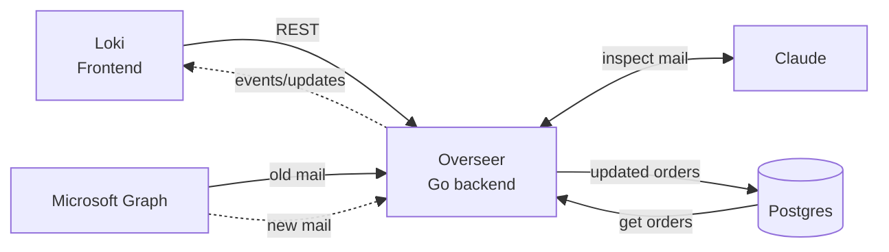
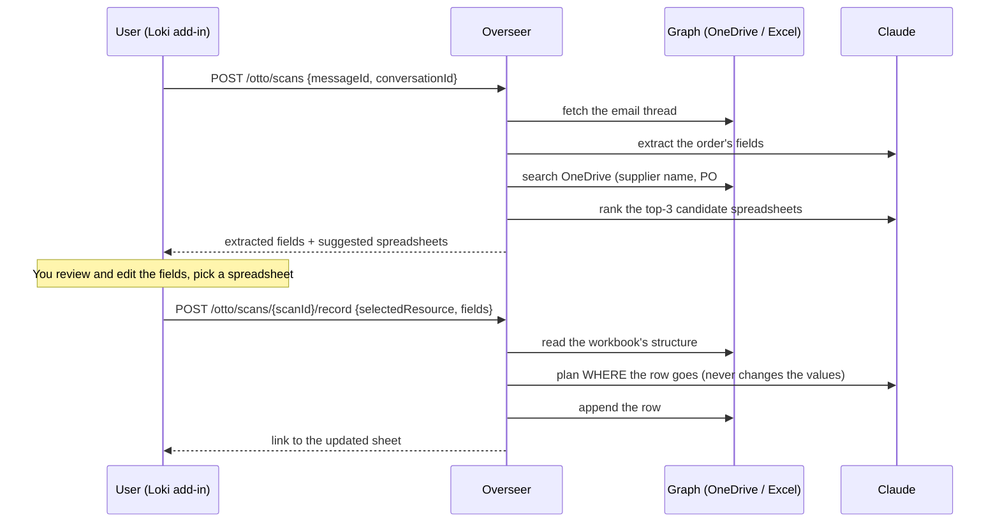

# Overseer

**Overseer** is the backend server behind **Scout** — ThirdEye's AI assistant for purchasing teams at wholesale distributors.

The problem it solves: when you buy from suppliers, everything about your orders — confirmations, delays, price changes — lives buried in email threads. Overseer reads those emails (through Microsoft Graph), understands them (with Claude), and turns them into three things the operator sees right inside Outlook:

1. **A live list of every open order**, built from the inbox and kept up to date automatically.
2. **Alerts when a supplier quietly changes something** — a price bump, a slipped delivery date, a smaller quantity.
3. **One-click order entry**: log an order into the right Excel spreadsheet without retyping it.

> **Who's who:** **Scout** is the product · **Overseer** is this backend · **Loki** is the Outlook add-in UI (separate repo) · **Otto** is the email→spreadsheet feature.

Here is the whole system in one picture. **Solid arrows are calls; dotted arrows are pushes** that arrive on their own.



Two flows: **user-driven** — Loki calls the API, a usecase reads mail and files from Graph, asks Claude to make sense of them, saves the result to Postgres, and announces it on the websocket. **Mail-driven** — Microsoft pushes a new-mail notification, a background job updates the order and runs the audit, and the events reach Loki without anyone asking.

## Video demo (backend)

**Live Order List Update**: An incoming email is recieved describing that September 22nd is the new arrival date for the PO. Overseer recieves this email via MSFT Webhook, sends it to the LLM & receives the updated payload patching the orders DB Table all in realtime. 

<video src="https://github.com/user-attachments/assets/3164e5a3-67b0-4141-891d-084dac13eec2" controls width="600"></video>

**One key design decision: Overseer never stores your email.** It only stores what it *derives* from email — orders, alerts, scan results. Whenever it needs the original messages again, it re-fetches them from Microsoft. Your mailbox stays the single source of truth.

## Contents

- [What Overseer does (the features)](#what-overseer-does-the-features)
- [The API](#the-api)
- [How the code is organized](#how-the-code-is-organized)
- [Running it locally](#running-it-locally)
- [Testing](#testing)
- [Repository map](#repository-map)
- [Status & roadmap](#status--roadmap)
- [Guide: adding tests for a feature](#guide-adding-tests-for-a-feature)
- [Guide: trying it live with emails to yourself](#guide-trying-it-live-with-emails-to-yourself)

---

## What Overseer does (the features)

| Feature | In one sentence | Status |
|---|---|---|
| **Order List — first sync** | Reads ~30 days of inbox once and builds the initial order list | ✅ Built |
| **Order List — live updates** | Every new supplier email updates its order in real time | ✅ Built |
| **Otto — email → spreadsheet** | Extracts an order, finds the right Excel file, and (after you approve) writes the row | ✅ Built |
| **Thread Audit** | Compares each new message against the thread's history and flags changes | ✅ Built |
| **Check-ups** | Scheduled follow-up emails to suppliers | 🔜 Specced, not built yet |

### 1. Order List — the first sync

When a user first connects, Overseer builds their order list from scratch. The add-in calls `POST /sync`, gets an immediate `202` reply, and the work runs in the background:

1. Fetch the last 30 days of the inbox from Microsoft Graph.
2. Ask Claude which conversations are actually about orders. This is one cheap pass over the whole batch — newsletters, receipts, and other noise are dropped here.
3. Group the surviving messages into threads, then ask Claude to extract the facts from each thread: supplier name, PO number, order status, estimated delivery dates, and a quote from the email that backs it all up.
4. Save each thread as one row in the `orders` table. Two safety properties here: running sync twice never creates duplicates (each order is keyed by its email conversation, so it updates in place), and nothing is written to the database until *all* the AI work has succeeded — a failed sync can't leave behind a half-finished list.
5. Announce `sync.completed` on the websocket so the UI knows to refresh.

From then on, `GET /orders` serves the list, with status filtering and pagination.

Code: [`build_active_order_list.go`](overseer/internal/usecase/orders/build_active_order_list.go), [`format_initial_order_data.go`](overseer/internal/usecase/orders/format_initial_order_data.go)

### 2. Order List — staying up to date

After the first sync, the list keeps itself current using Microsoft's **webhooks** (push notifications for new mail):

1. `POST /subscriptions` tells Microsoft: *"call me whenever this inbox gets a new message."*
2. When mail arrives, Microsoft calls `POST /webhooks/graph`. This endpoint is protected by a shared secret (`clientState`) instead of a login token, because Microsoft doesn't have one. Overseer immediately replies "got it" and does the real work in the background.
3. The background job figures out whose mailbox fired, fetches the new message, checks whether it's order-related, extracts the facts, and folds them into the existing order. New information updates fields — it never wipes out what was already known.
4. An `order.updated` event goes out on the websocket, and the Thread Audit (feature 4) runs on the same thread.

One maintenance detail: Microsoft subscriptions expire after about 3 days. A background worker checks every hour and renews any subscription that's within 12 hours of expiring, so the pipeline never silently goes deaf.

Code: [`handle_change_message.go`](overseer/internal/usecase/messages/handle_change_message.go), [`usecase/subscriptions/`](overseer/internal/usecase/subscriptions/)

### 3. Otto — email → spreadsheet, with you in the loop

Otto takes an order email and logs it into the operator's Excel sheet. The rule that shapes the whole design: **nothing is ever written to a spreadsheet without explicit human approval.** That's why Otto works in two separate steps — a *scan* that only reads, and a *record* that only happens after you confirm.



**Step 1 — Scan** (`POST /otto/scans`): Otto reads the whole thread, extracts the order fields, searches the user's OneDrive for likely spreadsheets, and has Claude rank the three best candidates. The result is saved as a "scan" so step 2 can only ever act on what the user actually saw.

**Step 2 — Record** (`POST /otto/scans/{scanId}/record`): the user reviews the extracted fields (fixing anything wrong), picks a destination, and confirms. Claude's only job here is *placement* — which table, which value goes in which column. The values written are exactly what the user approved, character for character. The response includes a `webUrl` link so the user can open the sheet and see the new row.

Guard rails: recording the same scan twice returns `409 Conflict`; recording a scan that doesn't exist returns `404`.

Code: [`resolve_destinations.go`](overseer/internal/usecase/otto/resolve_destinations.go), [`record_order.go`](overseer/internal/usecase/otto/record_order.go)

### 4. Thread Audit — catching quiet changes

Suppliers change things mid-thread: *"quick update, delivery slipped two weeks"* or *"small surcharge, unit price is now $4.85."* These are easy to miss in a busy inbox. Audit catches them.

It has no infrastructure of its own — it runs inside the webhook job whenever a new message arrives in a thread Overseer already tracks:

1. Re-fetch the entire thread from Microsoft.
2. Ask Claude: *compare this new message against the history. Did the price change? Did a date slip? Did a quantity shrink?*
3. Store each finding with a priority (`high`/`medium`/`low`), a category (`price`/`date`/`unit`), the exact quotes from both emails that prove it, and a deep link back to the message — then announce it as a `discrepancy.found` event.

If nothing changed, nothing is stored. The first message of a thread is never audited (there's no history to contradict yet). The UI reads findings with `GET /discrepancies` and closes them with `PATCH /discrepancies/{id}` (`open` → `resolved` or `dismissed`).

Code: [`catch_discrepancies.go`](overseer/internal/usecase/orders/catch_discrepancies.go)

### 5. The realtime channel

All live updates reach the UI through **one** websocket: `GET /ws`. Every message on it has the same shape — `{"type": "...", "data": {...}}` — and there are three types today: `sync.completed`, `order.updated`, and `discrepancy.found`.

The rule for growth: new features add new event *types*, never a second socket. The channel is one-way — the client only listens, and anything it sends is ignored.

### 6. Login (the current MVP shortcut)

Every route except the webhook requires `Authorization: Bearer <token>`, where the token is the add-in's own Microsoft Graph token — Overseer passes it straight through to Microsoft when it needs to read mail or files.

For now the system is **single-user**: any valid-looking token resolves to the one seeded user. The most recent token is also kept in memory, so background jobs (webhook processing, subscription renewals) can call Microsoft on the user's behalf. A durable multi-user login comes later.

---

## The API

All routes are wired up in [`router.go`](overseer/internal/controller/http/router.go).

| Method | Path | What it does | Success |
|---|---|---|---|
| `POST` | `/sync` | Start the first inbox sync (runs in background) | `202 {syncId}` |
| `GET` | `/orders` | The order list — filter/paginate with `?status=&cursor=&limit=` | `200 {orders, nextCursor}` |
| `GET` | `/ws` | The single realtime channel | `101` upgrade |
| `POST` | `/subscriptions` | Create/replace the user's new-mail subscription | `201` |
| `GET` | `/discrepancies` | List audit findings — `?status=` | `200` |
| `PATCH` | `/discrepancies/:discrepancyId` | Resolve or dismiss a finding | `200` |
| `POST` | `/otto/scans` | Otto step 1: extract fields + suggest spreadsheets | `200` |
| `POST` | `/otto/scans/:scanId/record` | Otto step 2: human-approved write to Excel | `200 {webUrl, status}` |
| `POST` | `/webhooks/graph` | Where Microsoft delivers new-mail notifications (secret-authed, no bearer) | `200` / `202` |

Request and response fields are camelCase ([`dto.go`](overseer/internal/controller/http/dto.go)). Who you are always comes from the auth token — any `userId`/`accountId` in a request body is ignored.

---

## How the code is organized

### The one rule

Every dependency points the same direction:

```
controller / worker  →  usecase  →  gateway / repo
```

In plain terms:

- **Controllers** (HTTP handlers) and **workers** (background loops) receive work and hand it to a usecase. They hold no business logic.
- **Usecases** hold *all* the business logic — every decision, every orchestration step, including the AI call sequences.
- **Gateways** (Microsoft Graph, Claude, OneDrive, Excel) and **repos** (Postgres) just do what they're told: call an API, run a query. No decisions.

A usecase never knows which concrete gateway it's talking to. It declares small interfaces (**ports**) in its own `ports.go` describing what it needs, and the real implementations are plugged in at startup in [`cmd/overseer/main.go`](overseer/cmd/overseer/main.go) — the only file where the layers meet. That plug-in is type-checked, so if a gateway's method signature ever drifts from what a usecase expects, the project stops compiling.

### Folder layout

```
overseer/
├── cmd/overseer/            # startup: config, wiring, background workers
├── db/migrations/           # database migrations (auto-applied at startup)
└── internal/
    ├── entity/              # core domain types — plain Go, no JSON/DB tags
    ├── usecase/
    │   ├── orders/          # first sync, order list, audit, finding status
    │   ├── messages/        # the webhook background job
    │   ├── otto/            # Otto scan + record
    │   └── subscriptions/   # create + renew Microsoft subscriptions
    ├── gateway/
    │   ├── graph/           # Microsoft Graph: mail + subscriptions
    │   ├── drive/           # OneDrive: search, recents, file lookup
    │   ├── excel/           # Excel: read workbook structure, append rows
    │   └── llm/             # Claude: prompts, retries, output validation
    ├── repo/                # Postgres — every SQL statement lives here
    ├── controller/http/     # HTTP router, auth middleware, handlers
    ├── controller/ws/       # the websocket hub
    ├── tokencache/          # in-memory Graph token cache
    └── testutil/            # shared fakes used by the E2E tests
```

### Tech stack

| Layer | Choice |
|---|---|
| Language | Go 1.26 |
| HTTP | Echo v4 |
| Realtime | gorilla/websocket |
| Database | Postgres 16 (pgx v5) |
| Migrations | dbmate (CLI + embedded at startup) |
| LLM | Anthropic Go SDK — default model `claude-opus-4-8`, structured JSON output |
| External API | Microsoft Graph v1.0 (mail, subscriptions, OneDrive, Excel) |

### Database

Six tables. The migration files in [`overseer/db/migrations/`](overseer/db/migrations/) are the source of truth, and every domain table carries an `account_id` + `user_id`.

| Table | What it stores |
|---|---|
| `accounts` | The customer company (the distributor) |
| `users` | The operator whose mailbox is watched |
| `graph_subscriptions` | The one active new-mail subscription per user, with its expiry (read by the renewal worker) |
| `orders` | The derived order list — supplier, PO number, status, original + current estimated dates, supporting quote. One row per email conversation. |
| `discrepancies` | Audit findings — status, priority, title, the supporting quotes, and an email deep link |
| `otto_scans` | One Otto interaction — the extracted fields, the chosen spreadsheet, and its status (`scanned` / `recorded` / `abandoned`) |

Allowed values (order status, finding priority, and so on) are declared once in `internal/entity` and enforced in two places: when validating Claude's output, and as CHECK constraints in the database.

---

## Running it locally

```sh
cd overseer
cp .env.example .env         # then fill in ANTHROPIC_API_KEY
make db-up                   # start Postgres via docker compose
make run                     # migrations auto-apply, server listens on :8080
```

### Configuration

| Env var | Default | Purpose |
|---|---|---|
| `PORT` | `8080` | HTTP listen port |
| `DATABASE_URL` | local Postgres DSN | Also read by the dbmate CLI |
| `ANTHROPIC_API_KEY` | — (required) | Key for the Claude API |
| `LLM_MODEL` | `claude-opus-4-8` | Override the model |
| `PUBLIC_BASE_URL` | `http://localhost:8080` | The address Microsoft uses to reach `/webhooks/graph` |
| `GRAPH_CLIENT_STATE` | `overseer-dev-client-state` | Shared secret checked on every webhook delivery |
| `SEED_ACCOUNT_NAME` / `SEED_USER_EMAIL` | dev values | The single seeded account/user |
| `LOG_LEVEL` | `info` | Set to `debug` to log raw Claude responses |

`make run` loads `.env` for you; the binary itself only reads real environment variables. Migrations can also be run standalone: `make migrate`, `make migrate-status`.

### Testing

```sh
make test    # fast and deterministic — no database, no network
```

Three tiers of tests (the [testing guide below](#guide-adding-tests-for-a-feature) explains each in depth):

- **Usecase unit tests** — the business logic, tested against hand-written fakes.
- **Controller E2E tests** — a real HTTP request through the real router and usecases, with only the outer edges (Microsoft, Claude, the database) faked.
- **Live LLM eval** — one test that calls the real model against a fixture built from production traffic. It skips itself unless `ANTHROPIC_API_KEY` is set.

---

## Repository map

```
.
├── overseer/           # the Go backend (everything above)
├── docs/tech_spec.md   # the full Scout product & tech spec — the authoritative source
├── .ai/                # architecture map + Go code-organization conventions
└── Building-Journal/   # per-feature build journals (sync, post-sync, audit, Otto)
```

Every feature so far has followed the same build path, journaled step by step: plan → entity + migration → gateway methods → repo → usecase → controller wiring → E2E test.

## Status & roadmap

- **Built:** the first sync, live updates, subscription lifecycle, Thread Audit, Otto scan/record, the realtime channel.
- **Next:** **Check-ups** — scheduled follow-up emails to suppliers, with automatic cancellation when the supplier replies (hooks into the existing webhook job).
- **Known MVP shortcuts:** single-user login (any token maps to the seeded user); Graph tokens live in memory and are lost on restart; Otto's scan runs synchronously.

---

## Guide: adding tests for a feature

Every feature ships with the same three test layers, and none of them touch a database or the network — `make test` runs cold, fast, and deterministic.

| Layer | What it proves | Where it lives |
|---|---|---|
| **Usecase unit test** | The business logic is right, tested against fakes of the usecase's ports | Next to the usecase, e.g. [`record_order_test.go`](overseer/internal/usecase/otto/record_order_test.go) |
| **Controller E2E test** | The full HTTP journey works — real router, real auth middleware, real usecases; only the outer edges faked | [`overseer/internal/controller/http/*_e2e_test.go`](overseer/internal/controller/http/) |
| **Gateway test** | The adapter speaks the external API's actual wire format | `httptest`-server tests, e.g. [`graph_test.go`](overseer/internal/gateway/graph/graph_test.go) |

### The shared fakes

[`testutil/fakes.go`](overseer/internal/testutil/fakes.go) holds one fake per external dependency, and they all work the same way: **set public fields to script what the fake should return, and read public slices/counters to see what was asked of it.** No mocking framework — tests read as plain arrange → act → assert.

| Fake | Stands in for | Script these fields → read these back |
|---|---|---|
| `FakeGraph` | Microsoft Graph mail + subscriptions | `Messages`, `MessagesByID`, `ConversationsByID` → `GetCalls`, `ConversationsFetched`, `TokensSeen` |
| `FakeLLM` | Claude | `FilterResult`, `Extractions`, `Findings`, `RankResult`, `PlanResult` → `ExtractCalls`, `PlanFieldsSeen`, … |
| `FakeDrive` / `FakeExcel` | OneDrive / Excel | `SearchResults`, `RecentItems`, `Structures` → `QueriesSeen`, `Appends` |
| `InMemOrders` / `InMemDiscrepancies` / `InMemOttoScans` / `InMemSubscriptions` | The Postgres tables | seed via `Upsert`/`Insert`/`AddUser` → `Count()`, `All()` |
| `EventRecorder` | The websocket hub | — → `Events`, `OfType(t)` |
| `FakeTokens` / `StaticResolver` | Token cache / login | `Put(userID, token)` / a fixed `User` |

### What an E2E test looks like

`newEnv(t)` in [`orders_e2e_test.go`](overseer/internal/controller/http/orders_e2e_test.go) builds a fully wired test server — real router, real usecases, fakes at the edges — and returns an `env` struct that gives your test a handle on every fake. Two details keep it deterministic: background jobs run synchronously in tests (no goroutine races), and `StaticResolver` stands in for single-user login.

Writing a new test is three steps — seed the fakes, hit the endpoint, then assert **both** the HTTP response **and** the side effects:

```go
func TestPostSync_SeedsOrderAndPublishesEvent(t *testing.T) {
	e := newEnv(t)
	// 1. Arrange: script what Graph and Claude "would" return
	e.graph.Messages = []entity.EmailMessage{
		{ID: "m1", ConversationID: "conv-a", Subject: "PO #4471 confirmed"},
	}
	e.llm.FilterResult = []string{"conv-a"}
	e.llm.Extractions = map[string]entity.OrderExtraction{
		"conv-a": {CompanyName: "Delmar Tooling", OrderID: 4471, Status: entity.OrderStatusConfirmed},
	}

	// 2. Act: a real HTTP request through the real router + middleware
	resp, _ := e.request(t, http.MethodPost, "/sync", true)

	// 3. Assert: the response AND the side effects
	if resp.StatusCode != http.StatusAccepted {
		t.Fatalf("status = %d, want 202", resp.StatusCode)
	}
	if e.repo.Count() != 1 {
		t.Errorf("orders = %d, want 1", e.repo.Count())
	}
	if got := e.events.OfType(entity.EventSyncCompleted); len(got) != 1 {
		t.Errorf("sync.completed events = %d, want 1", len(got))
	}
}
```

### Recipes: what to seed and assert, per feature

- **First sync** — script `graph.Messages`, `llm.FilterResult`, `llm.Extractions` → `POST /sync` → assert `repo.Count()` and one `sync.completed` event.
- **Live updates (webhook)** — script `graph.MessagesByID`; register the user + subscription on `InMemSubscriptions`; cache a token with `FakeTokens.Put` (the webhook carries no bearer token of its own) → `POST /webhooks/graph` with a notification body (`{"value":[{"subscriptionId":…,"clientState":…,"resourceData":{"id":…}}]}`) → assert the order was updated and an `order.updated` event fired. Always test the negative case too: a wrong `clientState` must be dropped, not processed ([`webhooks_e2e_test.go`](overseer/internal/controller/http/webhooks_e2e_test.go) does exactly this).
- **Thread Audit** — seed an existing order; script `graph.ConversationsByID` (the full thread) and `llm.Findings` keyed by the *new* message's id → fire the webhook → assert `discs.Count()` and a `discrepancy.found` event.
- **Otto scan** — script the thread, `llm.Extractions`, `drive.SearchResults`, `llm.RankResult` → `POST /otto/scans` → assert the response's `extractedFields` and `destinations`, and that exactly one scan row exists. On failure paths, assert **no scan row leaked**.
- **Otto record** — seed a scan on `InMemOttoScans`; script `excel.Structures`, `llm.PlanResult`, `drive.Items` → `POST /otto/scans/{id}/record` → assert `excel.Appends` received exactly the planned row, and that `llm.PlanFieldsSeen` saw the *user-edited* fields rather than the stored ones. Then the contract cases: unknown scan → `404`, recording twice → `409`.

### Checklist for a brand-new feature

1. **Entity first** — add the domain types + validators in `internal/entity` with table-driven tests (example: [`discrepancy_test.go`](overseer/internal/entity/discrepancy_test.go)).
2. **Usecase, test-driven** — declare the interfaces the usecase needs in its own `ports.go`, fake them locally in the `_test.go`, and test the orchestration: partial failures, safe re-delivery, "all AI work finishes before any write."
3. **New gateway method?** Add an `httptest`-server test asserting the exact outgoing request (path, query, body, auth header) — and mirror the new method onto the matching `testutil` fake.
4. **E2E** — add the new fake to the `env` struct, wire the controller in `newEnv`, then cover the happy path plus every documented error status.
5. **Wire it at startup** — plug the real gateway/repo into the usecase's interface-typed fields in [`main.go`](overseer/cmd/overseer/main.go). That assignment is itself the compile-time check: if a port and its implementation drift apart, the build fails.
6. `make test && make vet` — still no database, still no network.

### The live LLM eval (the one test that costs money)

[`filter_live_test.go`](overseer/internal/gateway/llm/filter_live_test.go) runs the **real model** against a fixture inbox built from production traffic — including the account-security junk mail that fooled the filter three times in the wild. It skips itself when no key is set:

```sh
cd overseer
ANTHROPIC_API_KEY=sk-ant-... go test ./internal/gateway/llm -run TestFilterOrderMessagesLive -v
```

Run it whenever you change a prompt in `gateway/llm` — prompt regressions never show up in the faked tests.

---

## Guide: trying it live with emails to yourself

You can exercise every feature end-to-end against your own mailbox — no real supplier needed. You play both roles: the operator (through the API) and the supplier (through emails you send yourself).

**You'll need:** a Microsoft account with Outlook + OneDrive, an Anthropic API key, `curl` + `jq`, and a websocket client (`npm i -g wscat`). A second email account (any Gmail) makes the supplier side more realistic, but replying to yourself works too.

### 1. Get a Microsoft Graph token

Open [Graph Explorer](https://developer.microsoft.com/en-us/graph/graph-explorer), sign in, and copy the token from the **Access token** tab.

- For the order list and audit features, consent to the **`Mail.Read`** permission.
- For Otto, you also need **`Files.ReadWrite`** — a mail-only token gets `403` on every OneDrive/Excel call. (This has bitten before.)
- Tokens expire after about an hour. When calls start returning `401 InvalidAuthenticationToken`, grab a fresh one.

```sh
export TOKEN="<paste from Graph Explorer>"
```

### 2. Stage a fake supplier thread in your inbox

Send yourself an email *as the supplier*, then keep **replying on the same thread** — replies share a conversation id, which is how Overseer knows messages belong together. A script that exercises everything:

> **Message 1 — the confirmation** (becomes the order row)
> Subject: `PO #4471 — Order Confirmation`
> Body: *"Hi, confirming your order PO #4471: 500 units of 3/8" carbide inserts at $4.20/unit. Estimated delivery August 15, 2026. — Dana, Delmar Tooling"*
>
> **Message 2 — the date slip** (a reply; bait for a `date` discrepancy)
> *"Quick update — the carbide inserts are now estimated for August 29 due to a mill delay."*
>
> **Message 3 — the price bump** (a reply; bait for a `price` discrepancy)
> *"Also flagging: material surcharge brings the unit price to $4.85."*

### 3. Start the server

```sh
cd overseer
cp .env.example .env      # fill in ANTHROPIC_API_KEY
make db-up
make run                  # serves on :8080
```

### 4. Watch the realtime channel

In a second terminal. Every pipeline announces its results here, so keep this open:

```sh
wscat -c ws://localhost:8080/ws -H "Authorization: Bearer $TOKEN"
```

### 5. Run the first sync (Order List)

```sh
curl -s -X POST localhost:8080/sync -H "Authorization: Bearer $TOKEN"
# → 202 {"syncId": "..."} ... then "sync.completed" appears on the websocket
curl -s "localhost:8080/orders" -H "Authorization: Bearer $TOKEN" | jq
```

Your Delmar Tooling thread should appear as an order, with your real inbox noise filtered out. If the filter misjudges something, set `LOG_LEVEL="debug"` in `.env` and rerun to see Claude's raw responses.

One side effect you want: this authenticated call also fills the in-memory token cache, which the webhook pipeline (next step) depends on.

### 6. Live updates — two ways to trigger them

**Option A — real webhooks (needs a public URL).** Microsoft must be able to reach your machine to verify the subscription, so open a tunnel first:

```sh
ngrok http 8080          # or: cloudflared tunnel --url http://localhost:8080
# set PUBLIC_BASE_URL="https://<tunnel-host>" in .env, restart make run
curl -s -X POST localhost:8080/subscriptions -H "Authorization: Bearer $TOKEN"
```

From now on every new email fires the pipeline for real: send Message 2 and watch `order.updated` arrive on the websocket.

**Option B — simulated notification (no tunnel needed).** Skip Microsoft's delivery and POST the notification yourself. Everything downstream still runs for real — the Graph fetch, the Claude call, the database write. First, seed a subscription row so the webhook can figure out whose mailbox it is:

```sh
docker compose exec postgres psql -U postgres overseer -c \
  "INSERT INTO graph_subscriptions (user_id, graph_subscription_id, expires_at)
   SELECT id, 'sub-local-1', now() + interval '2 days' FROM users LIMIT 1;"
```

Send Message 2, look up its real id in Graph Explorer (`GET /me/messages?$top=3&$select=id,subject,conversationId`), and fire the notification:

```sh
curl -s -X POST localhost:8080/webhooks/graph -H "Content-Type: application/json" -d '{
  "value": [{
    "subscriptionId": "sub-local-1",
    "changeType": "created",
    "clientState": "overseer-dev-client-state",
    "resourceData": { "id": "<real-message-id>" }
  }]
}'
```

Two things to know:

- `clientState` must match `GRAPH_CLIENT_STATE` (default shown above), or the notification is dropped as spoofed. Try a wrong value once to see it happen.
- The token cache is in-memory. **After any server restart, make one authenticated call (e.g. re-run `/sync`) before firing notifications** — otherwise the background job has no Microsoft token and skips the message.

### 7. Trip the auditor (Thread Audit)

Send Message 3 (the price bump) and fire its notification (or let the real webhook deliver it). `discrepancy.found` appears on the websocket:

```sh
curl -s "localhost:8080/discrepancies?status=open" -H "Authorization: Bearer $TOKEN" | jq
curl -s -X PATCH localhost:8080/discrepancies/<id> \
  -H "Authorization: Bearer $TOKEN" -H "Content-Type: application/json" \
  -d '{"status":"resolved"}'
```

The finding carries the category (`price`), a priority, the supporting quotes from both messages, and a deep link back to the email.

### 8. Record it with Otto (needs the `Files.ReadWrite` token)

In OneDrive, create `Orders.xlsx` and give it a **real Excel table**: type a header row (e.g. `PO | Supplier | Price | ETA`), select it, then *Insert → Table*. This matters because the Excel API appends to tables, not to loose cells. Naming the file something like `Delmar orders.xlsx` helps, since Otto searches OneDrive by supplier name and PO number.

```sh
# Step 1 — Scan: extract fields + suggest spreadsheets
# (messageId/conversationId come from Graph Explorer)
curl -s -X POST localhost:8080/otto/scans \
  -H "Authorization: Bearer $TOKEN" -H "Content-Type: application/json" \
  -d '{"messageId":"<real-message-id>","conversationId":"<real-conversation-id>"}' | jq

# Step 2 — Record: YOU approve — edit any field, pick a destination id from the scan response
curl -s -X POST localhost:8080/otto/scans/<scanId>/record \
  -H "Authorization: Bearer $TOKEN" -H "Content-Type: application/json" \
  -d '{"selectedResource":"<drive-item-id>","fields":{"companyName":"Delmar Tooling Inc.","orderId":4471,"status":"confirmed"}}' | jq
```

Open the returned `webUrl` — your row is in the sheet, with exactly the values you approved. Recording the same scan twice returns `409`.

### 9. Check the database

```sh
docker compose exec postgres psql -U postgres overseer
```

```sql
SELECT company_name, order_id, status, current_est_date FROM orders;
SELECT discrepancy_title, priority, status FROM discrepancies;
SELECT status, selected_resource FROM otto_scans;
```

### Troubleshooting

| Symptom | Cause / fix |
|---|---|
| `401 InvalidAuthenticationToken` from Graph | Token expired (~1 h) — grab a fresh one from Graph Explorer |
| `403` on `/otto/scans` | Token lacks `Files.ReadWrite` — re-consent in Graph Explorer |
| Webhook returns `202` but nothing happens | Check the server logs: `clientState mismatch` (wrong secret), `skipped_unknown_subscription` (no `graph_subscriptions` row), or an empty token cache (make one authed call after every restart) |
| `/sync` finds none of your emails | The filter judged them non-orders — make the supplier email more explicit (PO number, quantities, price) and check the `LOG_LEVEL=debug` output |
| `POST /subscriptions` fails | Microsoft couldn't validate the webhook — `PUBLIC_BASE_URL` must be reachable from the internet (tunnel running, value matches) |
