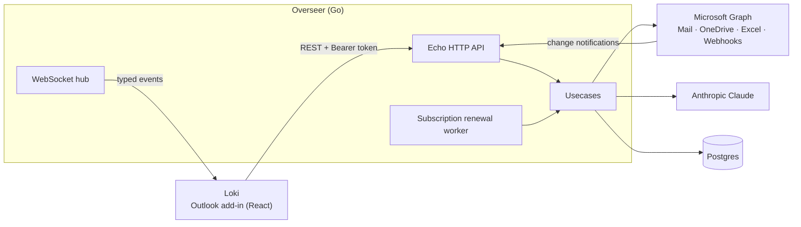
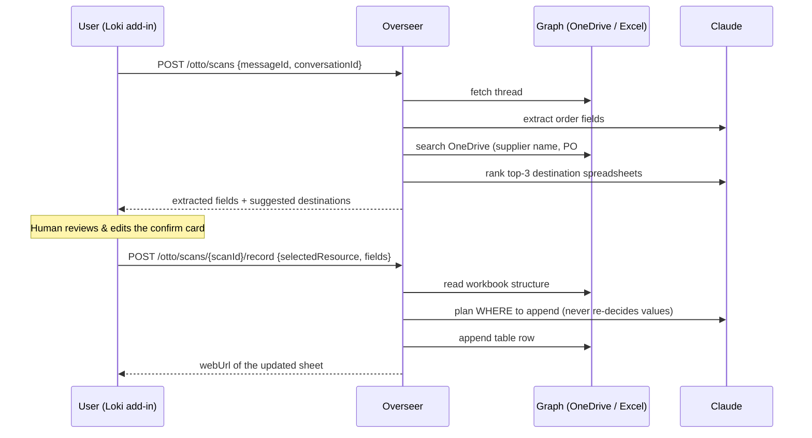

# Overseer

**Overseer** is the Go backend for **Scout** — ThirdEye's procurement AI assistant for wholesale distributors. It watches an operator's Outlook inbox through Microsoft Graph, uses Claude to turn messy supplier email threads into structured order data, and hands the operator a live order list, discrepancy alerts, and one-click ERP entry — all inside Outlook.

> **Naming cheat sheet:** **Scout** is the product · **Overseer** is this backend · **Loki** is the Outlook add-in UI (separate repo) · **Otto** is the email→ERP hero feature.



## Video Demo of BE 


<video src="https://github.com/user-attachments/assets/3164e5a3-67b0-4141-891d-084dac13eec2" controls width="600"></video>


A core design decision: **mail is never stored**. Overseer keeps only derived state (orders, discrepancies, scans) in Postgres and re-fetches threads from Graph on demand. The mailbox stays the source of truth.

---

## Features

| Feature | What it does | Status |
|---|---|---|
| **Order List — Sync** | One-time onboarding backfill: reads ~30 days of inbox, LLM-filters to order threads, extracts structured fields per thread | ✅ Built |
| **Order List — Live** | Graph webhooks keep the list current: every new supplier email is classified, extracted, and merged into its order in real time | ✅ Built |
| **Otto — email → ERP** | Extracts an order from a thread, finds the right spreadsheet in OneDrive, and — after human approval — appends the row to Excel | ✅ Built |
| **Thread Audit** | On every new message in a known order thread, compares it against the full history and flags discrepancies (price / date / unit) | ✅ Built |
| **Check-ups** | Scheduled follow-up emails to suppliers | 🔜 Specced, not yet built |

### Order List — Onboarding Sync

`POST /sync` returns `202 {syncId}` immediately and runs the backfill in the background:

1. `graph.ListMessages` pulls the last 30 days of inbox.
2. `llm.FilterOrderMessages` keeps only order-related conversations (one cheap pass over the whole batch).
3. Messages are grouped into threads; `llm.ExtractOrderFields` pulls supplier, PO number, status, estimated dates, and a supporting quote from each.
4. Orders are upserted idempotently on `(user_id, conversation_id)` — all LLM work finishes before any DB write, so a failed sync never leaves a partial seed.
5. A `sync.completed` event lands on the websocket.

The list is then served by `GET /orders` with status filtering and cursor pagination.

- Usecase: [`overseer/internal/usecase/orders/build_active_order_list.go`](overseer/internal/usecase/orders/build_active_order_list.go), [`format_initial_order_data.go`](overseer/internal/usecase/orders/format_initial_order_data.go)

### Order List — Live updates (Post-Sync)

`POST /subscriptions` registers a Microsoft Graph change-notification subscription for the user's inbox. From then on:

1. Graph POSTs to `POST /webhooks/graph` on every new message (authenticated by a shared `clientState` secret, not the bearer middleware). The handler echoes Graph's validation handshake and enqueues real notifications for background processing.
2. `HandleChangeMessage` resolves the subscription to a user, fetches the message, classifies it if the conversation is unseen, extracts fields, and **merge-upserts** the order — new information folds in without clobbering existing fields.
3. An `order.updated` event is pushed to the websocket, then the Audit leg runs (below).

Graph subscriptions expire after ~3 days, so a background worker ticks hourly and renews anything within 12 h of expiry (TTL 48 h).

- Usecases: [`overseer/internal/usecase/messages/handle_change_message.go`](overseer/internal/usecase/messages/handle_change_message.go), [`overseer/internal/usecase/subscriptions/`](overseer/internal/usecase/subscriptions/)

### Otto — email → ERP entry (human-in-the-loop)

Otto is a strict two-phase flow: **nothing is ever written to the ERP without explicit human approval.**



- **Scan** persists an `otto_scans` row so the record step operates only on what the user saw and approved.
- **Record** replays *approved fields only* — the LLM plans placement (which table, column mapping) but the values written are exactly what the user confirmed. Recording twice returns `409`; an unknown scan returns `404`.
- Usecases: [`overseer/internal/usecase/otto/resolve_destinations.go`](overseer/internal/usecase/otto/resolve_destinations.go), [`record_order.go`](overseer/internal/usecase/otto/record_order.go)

### Thread Audit — discrepancy detection

Audit has no infrastructure of its own; it rides the webhook job. When a new message arrives in a *known* order conversation:

1. `graph.ListConversationMessages` re-fetches the full thread.
2. `llm.FindDiscrepancies` compares the new message against the history — did the price change? the date slip? the quantity shrink?
3. Each finding is stored with a priority (`high`/`medium`/`low`), a metric type (`price`/`date`/`unit`), the supporting quotes, and a deep link back to the email — then pushed as a `discrepancy.found` event.

A clean thread stores nothing, and the first message of a conversation never audits (there's no history to contradict). Findings are listed via `GET /discrepancies` and cleared via `PATCH /discrepancies/{id}` (`open` → `resolved`/`dismissed`).

- Usecase: [`overseer/internal/usecase/orders/catch_discrepancies.go`](overseer/internal/usecase/orders/catch_discrepancies.go)

### Realtime channel

One websocket — `GET /ws` — carries every push the UI needs as typed events: `{"type": "...", "data": {...}}`. Current event types: `sync.completed`, `order.updated`, `discrepancy.found`. New features add event types, never new sockets. Clients only listen; inbound frames are discarded.

### Auth (MVP)

Every route except the webhook requires `Authorization: Bearer <Graph token>` — the add-in's own Graph-scoped token, passed straight through to Microsoft Graph. The MVP is single-user: any valid-looking token resolves to the seeded user, and the last-seen token is cached in memory so background jobs (webhooks, renewals) can call Graph on the user's behalf.

---

## API surface

All routes live in [`overseer/internal/controller/http/router.go`](overseer/internal/controller/http/router.go).

| Method | Path | Purpose | Success |
|---|---|---|---|
| `POST` | `/sync` | Kick off onboarding inbox sync (async) | `202 {syncId}` |
| `GET` | `/orders` | Order list — `?status=&cursor=&limit=` | `200 {orders, nextCursor}` |
| `GET` | `/ws` | The single realtime channel | `101` upgrade |
| `POST` | `/subscriptions` | Create/replace the user's Graph subscription | `201` |
| `GET` | `/discrepancies` | List audit findings — `?status=` | `200` |
| `PATCH` | `/discrepancies/:discrepancyId` | Update a finding's status | `200` |
| `POST` | `/otto/scans` | Ask Otto: extract fields + top-3 destinations | `200` |
| `POST` | `/otto/scans/:scanId/record` | Human-approved write to Excel | `200 {webUrl, status}` |
| `POST` | `/webhooks/graph` | Graph change notifications (`clientState`-authed, no bearer) | `200` / `202` |

Wire DTOs are camelCase and live in [`dto.go`](overseer/internal/controller/http/dto.go); `userId`/`accountId` always come from auth context, never the request body.

---

## Architecture

### The one rule

```
controller / worker  →  usecase  →  gateway / repo
```

Dependencies point inward, never back up. Each usecase package declares the small interfaces (**ports**) it needs in its own `ports.go`; gateways and repos satisfy them structurally and never import usecases. The composition root ([`overseer/cmd/overseer/main.go`](overseer/cmd/overseer/main.go)) is the only place layers are wired, and it carries compile-time conformance assertions (`var _ orders.MessageLister = (*graph.Client)(nil)`) so signature drift fails the build.

### Layout

```
overseer/
├── cmd/overseer/            # composition root: config, wiring, workers
├── db/migrations/           # dbmate migrations (also embedded, auto-applied at startup)
└── internal/
    ├── entity/              # domain types — no JSON/DB tags, stdlib + uuid only
    ├── usecase/
    │   ├── orders/          # sync, list, audit, discrepancy status
    │   ├── messages/        # webhook job (HandleChangeMessage)
    │   ├── otto/            # scan (ResolveDestinations) + record (RecordOrder)
    │   └── subscriptions/   # ensure + renew Graph subscriptions
    ├── gateway/
    │   ├── graph/           # Microsoft Graph mail + subscriptions
    │   ├── drive/           # OneDrive search / recents / item lookup
    │   ├── excel/           # workbook structure + table row append
    │   └── llm/             # Anthropic Claude: prompts, retries, validation, cost logging
    ├── repo/                # Postgres via pgx — all SQL lives here
    ├── controller/http/     # Echo router, auth middleware, controllers, DTOs
    ├── controller/ws/       # realtime hub
    ├── tokencache/          # in-memory per-user Graph token cache
    └── testutil/            # shared fakes for E2E tests
```

Gateways are deliberately dumb adapters — no business decisions, no DB access. All orchestration (including the LLM agent loops) lives in usecases.

### Tech stack

| Layer | Choice |
|---|---|
| Language | Go 1.26 |
| HTTP | Echo v4 |
| Realtime | gorilla/websocket |
| Database | Postgres 16 (pgx v5 / pgxpool) |
| Migrations | dbmate (CLI + embedded at startup) |
| LLM | Anthropic Go SDK — default model `claude-opus-4-8`, structured JSON output |
| External API | Microsoft Graph v1.0 (mail, subscriptions, OneDrive, Excel) |

### Database

Every domain table carries `account_id` + `user_id`. Migrations in [`overseer/db/migrations/`](overseer/db/migrations/) are the source of truth.

| Table | Stores |
|---|---|
| `accounts` | Tenant — the distributor company |
| `users` | Operator whose mailbox is watched (unique email) |
| `graph_subscriptions` | One Graph webhook subscription per user, with expiry for the renewal worker |
| `orders` | Derived order list — keyed for upsert on `(user_id, conversation_id)`; supplier, PO number, status, original/current est. dates, last messenger, supporting quote |
| `discrepancies` | Audit findings — status, priority, title, JSONB detail + quotes, email deep link |
| `otto_scans` | One Ask-Otto interaction — extracted fields (JSONB), selected destination, status (`scanned`/`recorded`/`abandoned`) |

Domain enums (`OrderStatus`: `in_transit`/`confirmed`/`delivered`/`issue`, discrepancy status/priority/metric, scan status) are declared once in `internal/entity` and enforced both at the LLM boundary and as DB CHECK constraints.

---

## Running it

```sh
cd overseer
cp .env.example .env         # fill in ANTHROPIC_API_KEY
make db-up                   # Postgres via docker compose
make run                     # migrations auto-apply, then serve :8080
```

### Configuration

| Env var | Default | Purpose |
|---|---|---|
| `PORT` | `8080` | HTTP listen port |
| `DATABASE_URL` | local Postgres DSN | Also read by the dbmate CLI |
| `ANTHROPIC_API_KEY` | — (required) | LLM gateway |
| `LLM_MODEL` | `claude-opus-4-8` | Model override |
| `PUBLIC_BASE_URL` | `http://localhost:8080` | Where Graph reaches `/webhooks/graph` |
| `GRAPH_CLIENT_STATE` | `overseer-dev-client-state` | Shared secret in every Graph notification |
| `SEED_ACCOUNT_NAME` / `SEED_USER_EMAIL` | dev values | Single-user MVP seed |
| `LOG_LEVEL` | `info` | `debug` logs raw LLM responses |

`make run` sources `.env`; the binary itself reads only real env vars (12-factor). Migrations also run standalone: `make migrate`, `make migrate-status`.

### Testing

```sh
make test    # no DB, no network
```

Three tiers:

- **Usecase unit tests** — every usecase tested against hand-written fakes of its ports.
- **Controller E2E tests** — full HTTP request → response through the real router, middleware, and usecases, with only the outermost adapters faked (fake Graph/LLM/Drive/Excel, in-memory repos, event recorder). See `*_e2e_test.go` in [`overseer/internal/controller/http/`](overseer/internal/controller/http/).
- **Live LLM eval** — [`filter_live_test.go`](overseer/internal/gateway/llm/filter_live_test.go) runs the real model against a production inbox fixture (including the account-security junk that fooled the filter in the wild); skipped unless `ANTHROPIC_API_KEY` is set.

---

## Repository map

```
.
├── overseer/           # the Go backend (everything above)
├── docs/tech_spec.md   # the full Scout product & tech spec — the authoritative source
├── .ai/                # ARCHITECTURE.md + Go code-organization conventions
└── Building-Journal/   # per-feature build journals (sync, post-sync, audit, Otto)
```

Every feature so far has followed the same build path, and it's all journaled: plan → entity + migration → gateway methods → repo → usecase → controller wiring → E2E test.

## Status & roadmap

- **Built:** Order List sync + live updates, Graph subscription lifecycle, Thread Audit, Otto scan/record, realtime channel.
- **Next:** **Check-ups** — scheduled supplier follow-up emails, with cancel-on-reply hooking into the existing webhook job.
- **Known MVP constraints:** single-user auth (any token resolves to the seeded user); Graph tokens cached in memory rather than a durable refresh-token flow; Otto scan runs synchronously.
